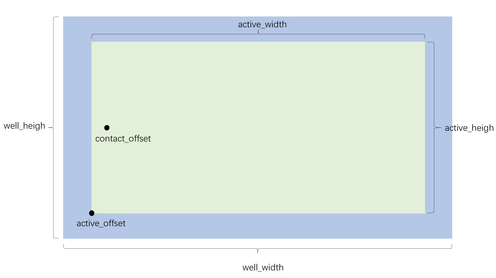
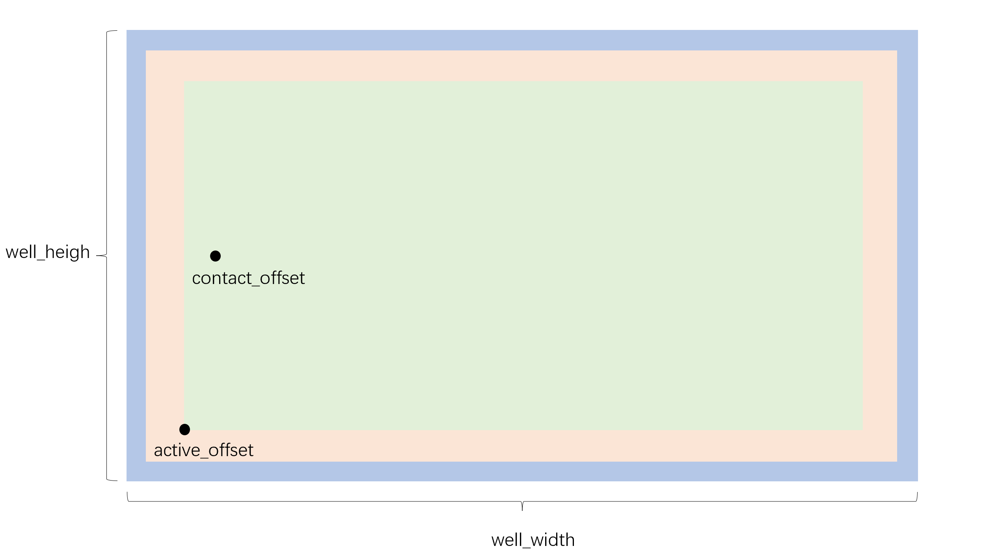
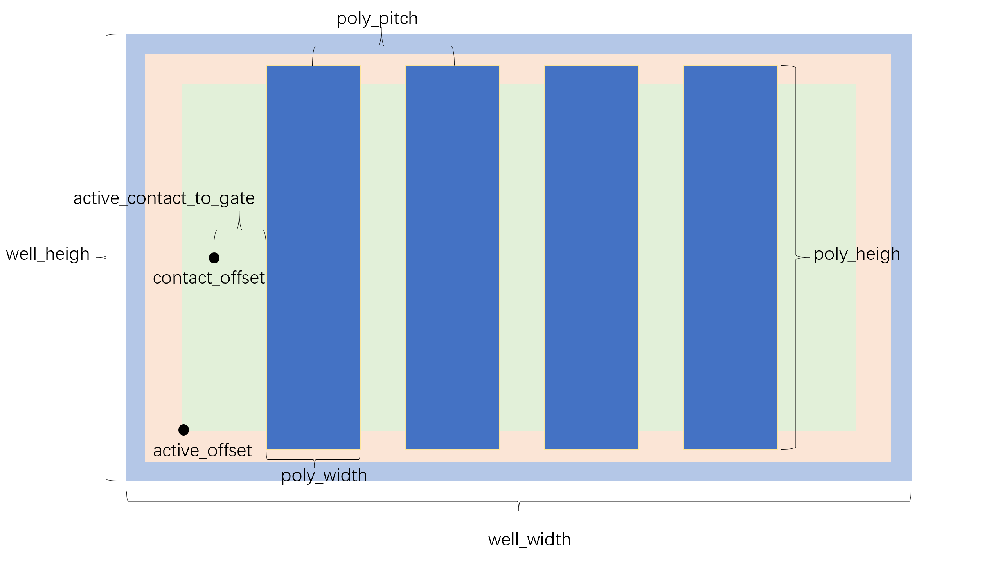
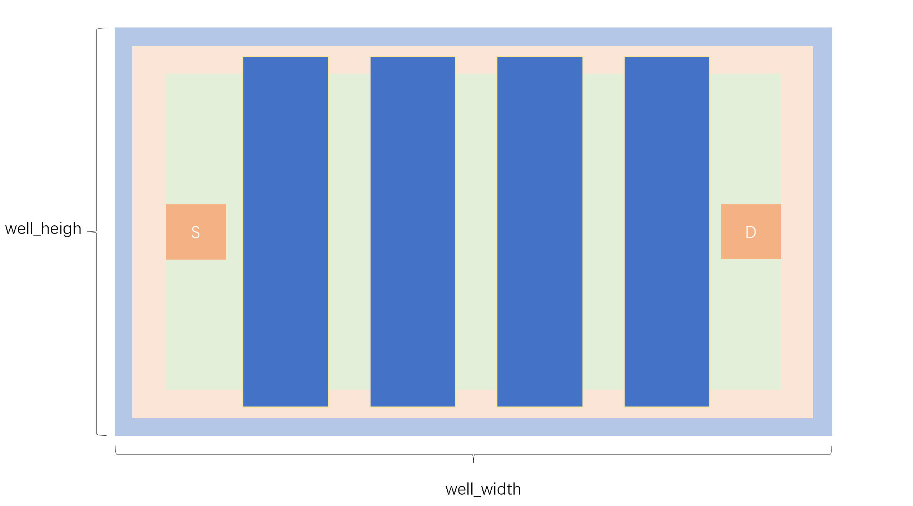
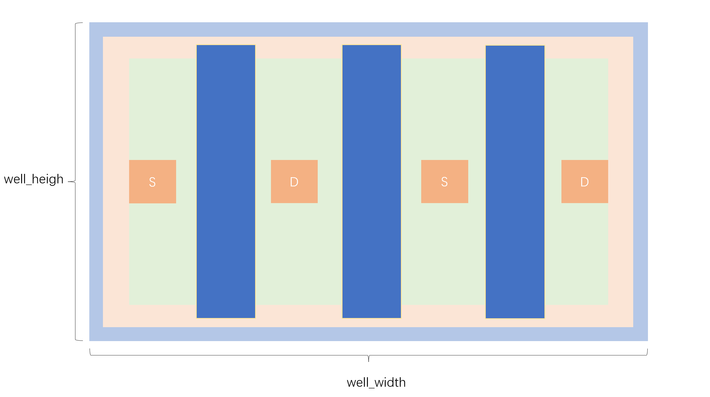
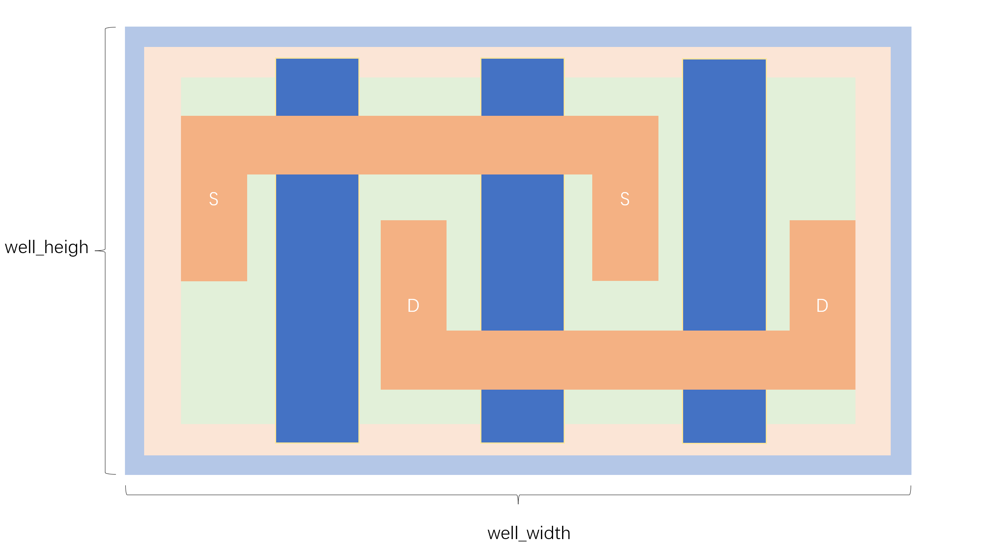

# ptx

>   This module generates gds and spice of a parametrically NMOS or
>
>   PMOS sized transistor.  Pins are accessed as D, G, S, B.  Width is
>
>   the transistor width. Mults is the number of transistors of the
>
>   given width. Total width is therefore mults*width.  Options allow
>
>   you to connect the fingered gates and active for parallel devices.
>
>   The add_*_contact option tells which layer to bring source/drain up to.
>
> 
>
>   ll, ur, width and height refer to the active area.
>
>   Wells and poly may extend beyond this.

这个模块生成参数化的 NMOS 或 PMOS 的 gds 与 spice。引脚是 D、G、S 与 B。

- Width 是晶体管宽度；
- Mults 是给定宽度下的晶体管数量；
- Total width 即为 Mults * Width；

允许为并联设备连接指控门和活动部件。


## `create_netlist`

1. 创建 port：`["D", "G", "S", "B"]`

2. 创建 spice 描述语句

   ````python
   main_str = "M{{0}} {{1}} {0} m={1} w={2}u l={3}u ".format(spice[self.tx_type],
                                                             self.mults,
                                                             self.tx_width,
                                                             self.channel_length)
   area_str = "pd={0:.2f}u ps={0:.2f}u as={1:.2f}p ad={1:.2f}p".format(perimeter_sd,                                                                           area_sd)
   self.spice_device = main_str + area_str
   self.spice.append("\n* spice ptx " + self.spice_device)
   ````


## `create_layout`

### `setup_layout_constants`

计算各层的长、宽、偏移量，依次计算：

1. `self.num_contacts`（总是 1）

2. `self.implant_type`、`self.well_type`（根据 `self.tx_type`）

3. `self.active_contact`：在 `active_stack` 创建 contacts（active_stack 连接 active 与 m1）

4. `self.poly_pitch`：poly 层两个区域的最小中心距离

   1. `self.contacted_poly_pitch`：`self.poly_space + self.poly_contact.width`。`self.poly_contact` 由 `layout.setup_contacts ` 创建，连接 m1 与 poly
   2. `self.contact_pitch`：
   3. ``self.min_poly_pitch`：`self.poly_space + self.poly_width`（poly 层两个区域的最小间距 + 每个区域的最小宽度 => 两个区域最小的中心距离）

   ````python
   self.poly_pitch = max(self.min_poly_pitch,
                                 self.contacted_poly_pitch,
                                 self.contact_pitch)
   ````

5. `self.end_to_contact`：` 0.5 * self.active_contact.width`，active 到 m1 contact 宽度的一半

6. `self.active_width`：

   ````python
   self.active_width =  
   	2 * self.end_to_contact + \
       self.active_contact.width + \
       2 * self.active_contact_to_gate + \
       self.poly_width + \
       (self.mults - 1) * self.poly_pitch
   ````

   - `2 * self.end_to_contact`：一个 active_contact 宽度
   - `self.active_contact.width`：一个 active_contact 宽度
   - `2 * self.active_contact_to_gate`：两个 active_contact 到 gate 的距离
   - `self.poly_width`：poly 层的线宽
   - `(self.mults - 1) * self.poly_pitch`：`(self.mults - 1)` 个 poly 层图形中心位置距离

   这些之和得到 active 层的宽度。

7. `self.active_height = self.tx_width`：active 的高度刚好就是需要的晶体管 W

8. `self.poly_height = self.active_height + 2 * self.poly_extend_active`：poly 的高度是 active 的高度多加两个 poly_extend_active（poly 需要包裹 active 层的距离）

9. `self.active_offset = vector([self.well_enclose_active] * 2)`：active 需要被 well 包裹，以 well 的 ll 坐标为 0 点，那么 active 的 ll 是 `vector([self.well_enclose_active] * 2)`

10. `self.well_width`：正常是 `self.active_width + 2 * self.well_enclose_active`（完全包裹 active），但这个值可能没有达到 DRC 中定义的 well 层的最小宽度，如果没有，就只能用 `well_width`。这里的 well 可能是 nwell 也可能是 pwell，根据 `self.well_type` 动态确定

11. `self.well_height = max(self.active_height + 2 * self.well_enclose_active, well_width_rule)`：同 `self.well_width`

12. ```python
    self.height = self.active_height
    self.width = self.active_width
    ```

13. ````python
    self.contact_offset = 
    	self.active_offset + \
        vector(0.5 * self.active_contact.width, 0.5 * self.active_height)
    ````

    `self.contact_offset` 位于 active 层的 y 中心，x 偏移 `0.5 * self.active_height` 的位置，用来打 contact，连接 S/D



### `add_active`

根据 active 的信息，add_rect 添加 active 层，还添加了 implant 层（用来作 D、S 用的）

1. 添加 active 层：

   ````python
   self.active = self.add_rect(layer="active",
                               offset=self.active_offset,
                               width=self.active_width,
                               height=self.active_height)
   ````

2. 计算 implant 信息：

   ````python
   enclose_width = self.implant_enclose_active
   enclose_offset = [enclose_width] * 2
   ````

3. 创建 implant 层：implant 包含了 active 

   ````python
   self.implant = self.add_rect(layer="{}implant".format(self.implant_type),
                                offset=self.active_offset - enclose_offset,
                                width=self.active_width + 2 * enclose_width,
                                height=self.active_height + 2 * enclose_width)
   ````



### `add_well_implant`

创建 well 层（可能是 nwell 也可能是 pwell，根据 tx_type）

1. 计算 well 中心坐标：

   ```python
   center_pos = self.active_offset + vector(0.5 * self.active_width,
                                            0.5 * self.active_height)
   well_ll = center_pos - vector(0.5 * self.well_width, 0.5 * self.well_height)
   ```

2. 创建 well 层

   ````python
   well = self.add_rect(layer=well_name,
                        offset=well_ll,
                        width=self.well_width,
                        height=self.well_height)
   ````


### `add_poly`

创建 poly 层，需要创建 self.mults 个，每个 poly 是通过一个 add_rect 与 add_pin_layout 创建

1. 计算 poly 层的中心位置：

   ````python
   poly_offset = self.contact_offset \
               + vector(
                   0.5 * self.active_contact.width \
                   + 0.5 * self.poly_width \
         			+ self.active_contact_to_gate, 
                   0
                 )
   ````

   以 `self.contact_offset` 基点，x 轴右移 半个 active_contact 宽度、右移半个 poly 层的宽度、右移 active_contact 到 gate 的距离。y 轴不变。

   所以 poly_offset 的 y 轴为 active 层的中心。

   而 x 轴以 active 层起始位置开始：跳过一个 active_contact 宽度、跳过 active_contact 到 gate 的距离，再经过半个 poly 层的宽度。

   这样，加上 poly 后，active_contact 与 poly 间隔恰好为 active_contact_to_gate。

2. 保存 poly 位置与 poly 对象：

   ````python
   self.poly_positions = []
   self.poly_gates = []
   ````

3. ````python
   for i in range(0, self.mults):
       self.add_rect_center(layer="poly",
                            offset=poly_offset,
                            height=self.poly_height,
                            width=self.poly_width)
   
       # pin_layout 对象！
       gate = self.add_layout_pin_rect_center(text="G",
                                              layer="poly",
                                              offset=poly_offset,
                                              height=self.poly_height,
                                              width=self.poly_width)
       self.poly_positions.append(poly_offset)
       self.poly_gates.append(gate)
   
       poly_offset = poly_offset + vector(self.poly_pitch, 0)
   ````

   循环 self.mults 次，每次创建一个 rect，以 poly_offset 为中心，高度为 poly_height、宽度为 poly_width。

   再以 poly_offset 为中心，高度为 poly_height、宽度为 poly_width，创建一个 pin_layout，名称为 G。

   将 poly_offset  与创建的 pin_layout 对象保存

   更新 poly_offset，x 轴右移一个 poly_pitch（poly 层图形中心间距）

4. ````python
           if self.connect_poly:
               self.connect_fingered_poly(self.poly_positions)
   ````

   connect_fingered_poly 是把刚才每次循环单独创建的 pin_layout 删除，把所有 poly 组成的大矩形创建一个 pin_layout。



右侧剩余的宽度：

```
active_width - (poly_width + (mults - 1) * poly_pitch) - active_contact.width - active_contact_to_gate
= active_contact.width  + active_contact
```

和左边刚好一样

### `add_active_contacts`

创建 S/D 的引脚。` self.add_source_contact` 与 `self.add_drain_contact` 指出了 S/D 引脚要连接到的层次（从 active 连接到特定层次）

如果是串联设备：self.series_devices：



如果不是：



最后可能需要连接 D 与 S：

````python
if self.connect_source_active:
    self.connect_fingered_active(source_positions, "S", top=(self.tx_type=="pmos"))

if self.connect_drain_active:
    self.connect_fingered_active(drain_positions, "D", top=(self.tx_type=="nmos"))
````

连接方法大致为：首先去掉原来的引脚，给坐标列表中，两两位置连接 path，最后再创建一个大的 pin_layout，都在 self.router_layer 进行。




## DRC 知识

1. **poly_space**：多晶硅（poly）层中两个不同的多晶硅区域之间的最小间距要求。
2. **poly_width**：多晶硅（poly）层中单个多晶硅区域的宽度。
3. **poly_pitch** ：多晶硅（poly）层中相邻多晶硅区域之间的中心到中心的距离