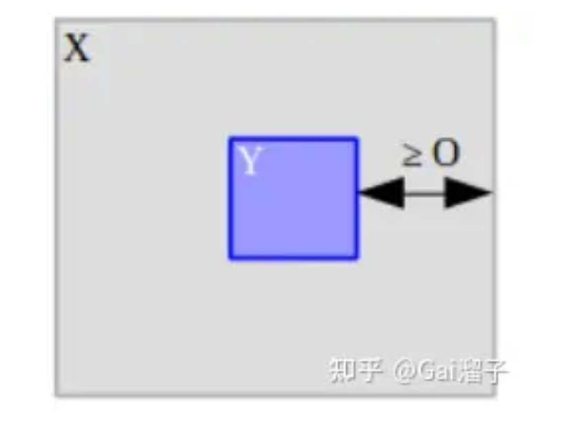

# 工艺库文件 tech.py

## DRC

OpenRAM 使用 design_rules 类对象表达 DRC 规则。内部包含一个工艺节点名称字段、一个 rules（dict 类型）字段存储 DRC 规则。

### layer 信息

```python
    def add_layer(self, name, width, spacing, area=0):
        # Minimum width
        self.add("minwidth_{}".format(name), width)
        # Minimum spacing (could be a table too)
        self.add("{0}_to_{0}".format(name), spacing)
        # Minimum area
        self.add("minarea_{}".format(name), area)
```

其中对 layer 的信息，drc 对象会保存下面三个信息：

- `minwidth_{layer_name}`：layer 层中的最小线宽
- `{layer_name}_to_{layer_name}`：layer 层中导线间最小宽度
- `minare_{layer_name}`：layer 层上形成的最小面积

tech.py 文件中需要对各层调用 add_layer：implant、active_contact、poly_contact、poly、m1、via1、m2、...m4。也就是所有层与 via。

### enclosure 信息

```python
    def add_enclosure(self, name, layer, enclosure, extension=None):
        self.add("{0}_enclose_{1}".format(name, layer), enclosure)
        # Reserved for asymmetric enclosures
        if extension:
            self.add("{0}_extend_{1}".format(name, layer), extension)
        else:
            self.add("{0}_extend_{1}".format(name, layer), enclosure)
```

给定 name、layer 以及 enclosure 值，name 是某个 layer 的名称，layer 是 name 层连接到的 via 名称。例如：

```python
drc.add_enclosure("m1", layer = "poly_contact", enclosure = _lambda_)
drc.add_enclosure("m1", layer = "active_contact", enclosure = _lambda_)
drc.add_enclosure("m1", layer = "via1", enclosure = _lambda_)
drc.add_enclosure("m2", layer = "via1", enclosure = _lambda_)
drc.add_enclosure("m2", layer = "via2", enclosure = _lambda_)
```

方法会添加以下几个信息：

- `{name}_enclose_{layer}`：via 用于连接，通常是在连接层与 via 层绘制包含关系的矩形来表示连接关系。这个参数指定了两个矩形边直接的距离：

  

- `{name}_extend_{layer}`：指定了 name 层的金属覆盖 layer 的程度，通常要求 name 层的金属至少延伸到 layer 的周围一定的距离，以确保良好的电气连接和制造可靠性

tech.py 中添加了所有用于连接的 layer 与其 via 直接的 enclosure 信息。

### `{}_to_{}`

在 add_layer 中，会添加 `layer_to_layer`，表示本层之间的最小距离，tech.py 还会添加不同 layer 的 to 信息：

````python
drc["poly_to_contact"] = 4*_lambda_
drc["poly_to_active"] = _lambda_
drc["poly_to_field_poly"] = 3*_lambda_
drc["active_contact_to_gate"] = 2*_lambda_
drc["poly_contact_to_gate"] = 2*_lambda_
````

