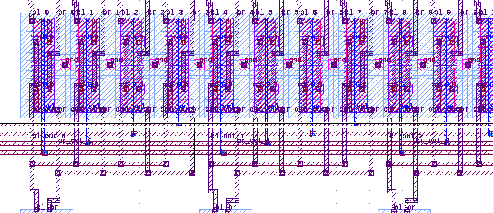
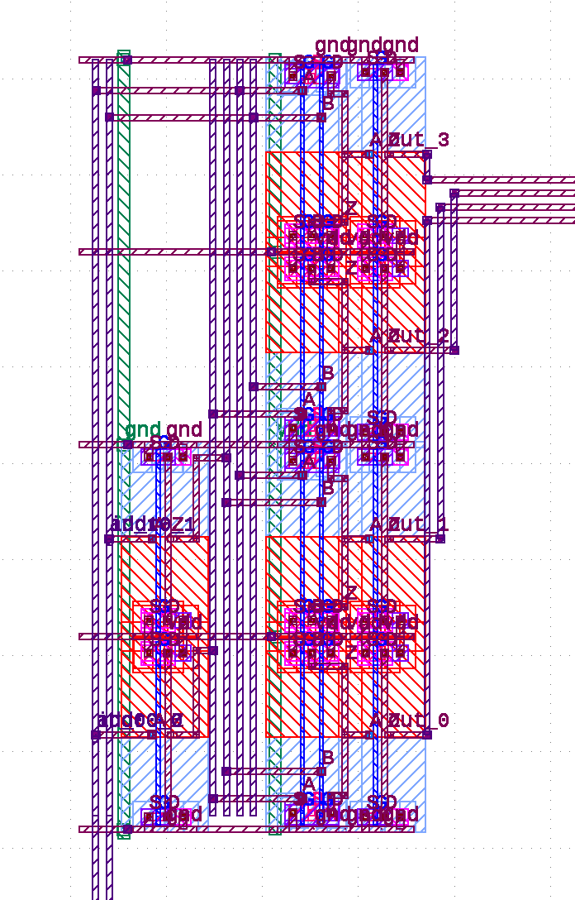
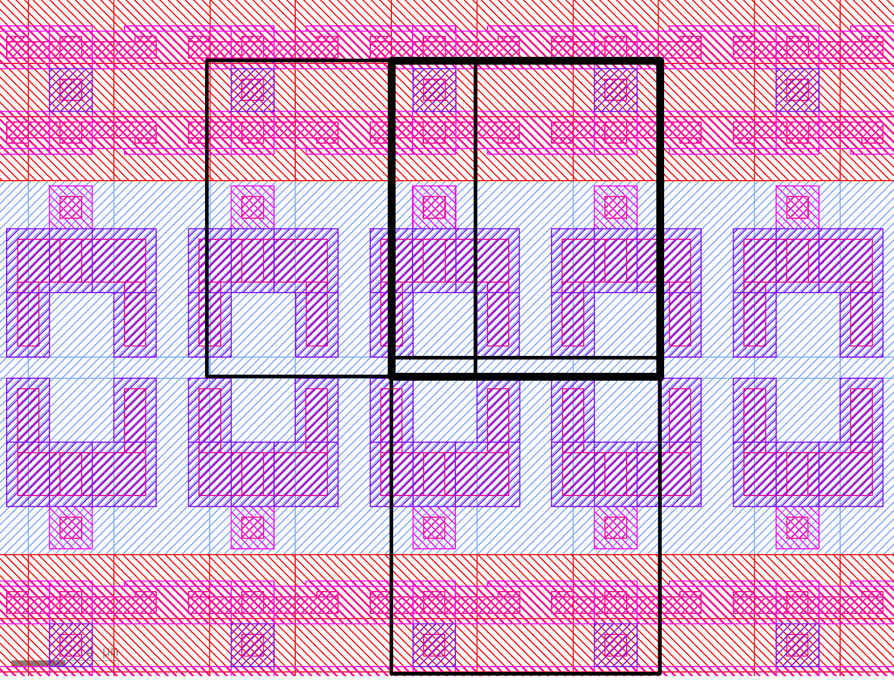
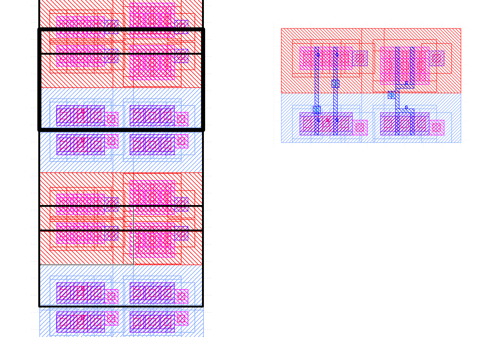

# 版图设计

- OpenRAM 的 cell_port

- 库模块电路（如 bitcell）的完整构造过程（在 design 构造时读取 .gds 文件，获取 pin_layout、height、width！）所以这些库模块的高度都是确定的

- 不同尺寸下的 SRAM 版图对比

- precharge_array、colunmux_array、sense_amp_array、bitcell_array

- port_data

- pre_decoder、decoder

- 一般一列摆放的instance，都是一个正常放置，下一个 MX 放置

- control_logic 有两种实现，一种使用 rbl 一种使用 延时链

- OpenRAM 支持三种端口：读写/读/写。但是最多只能有两个端口：2rw0r0w、1rw1r0w...

- Bank 中第 0 个 port 的模块摆放在左下角，第 1 个右上角

- contact

- pgate 类是 pand2、pand3 等基础模块的基类，构造函数允许指定高度！保证对齐（bitcell、and2 等高度都一致）

- 在 sram_factory 创建模块之前，会进行模块重载，查看 OPTS 中知否将模块重载，例如：

  ````python
  nand2_dec = "pnand2"
  ````

  这样创建 nand2_dec 时，其实会创建 pnand2 

- bitcell 阵列布线？正确放置所有 bitcell，因为在工艺库中提供的版图中，bitcell 的 WL 引脚与 bl/br 引脚是不同层的。用 m1 连接 wl 与 vdd（横着放，保证不会重叠！）；用 m2 连接 bl、br 与 gnd（都竖着放，保证不会重叠）

- col mux array：

  - bl、br 使用 m2 层，竖直布线
  - 输入 sel 使用 m1 层，水平布线
  - 各个选择器的输入 sel 使用 poly，竖直布线

  

- precarge array：

  - bl、br 使用 m2 层，竖直布线
  - en_bar 使用 m1 层，水平布线

- sense amp array：

  - bl、br 使用 m2 层，竖直布线
  - en 使用 m1 层，水平布线

- write array：

  - bl、br 使用 m2 层，竖直布线
  - en 使用 m1 层，水平布线

- decoder

  

  - 输入地址 m2 层，竖直布线
  - 地址输入线 => 一条原相、反相，使用 m1 层，水平连接到反相器输入与原相线
  - 二轮选择线，m2 层，竖直布线
  - sel 输出线，先 m2 再 m1 输出

  都不会重叠

- bitcell array 摆放时会部分重叠：

  

- 大部分的竖直元件摆放方式都很类似：

  - 偶数个的偏移为 i * height，不镜像（y 坐标向上增长）
  - 奇数个的偏移为 (i + 1) * height，MX 镜像（y 坐标向下增长）

  

  因为元件实际高度不是 height，使得两个元件之间有部分重叠