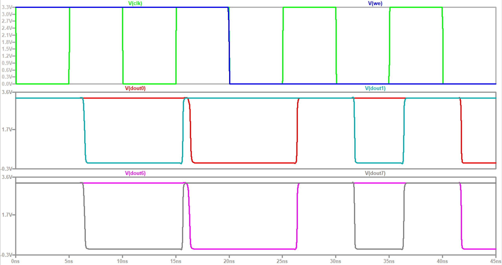
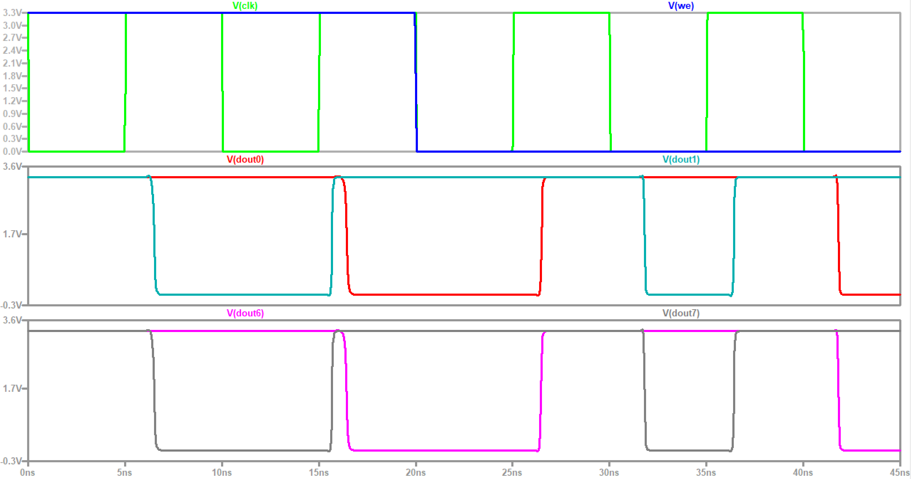
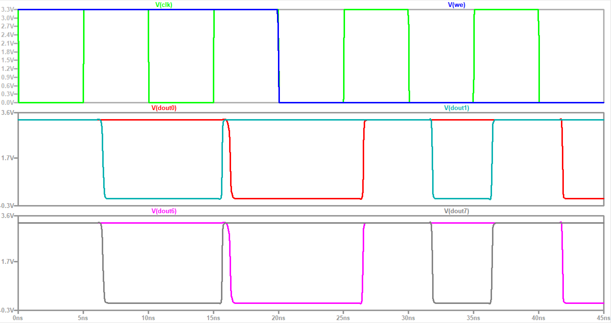
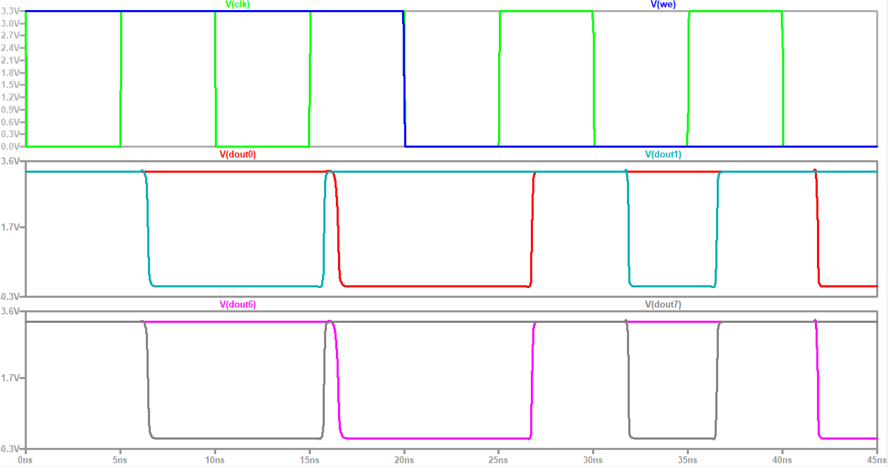
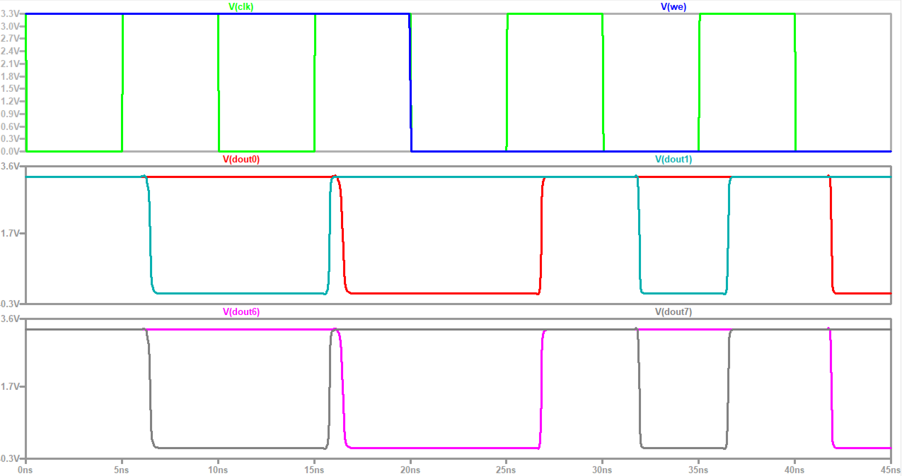
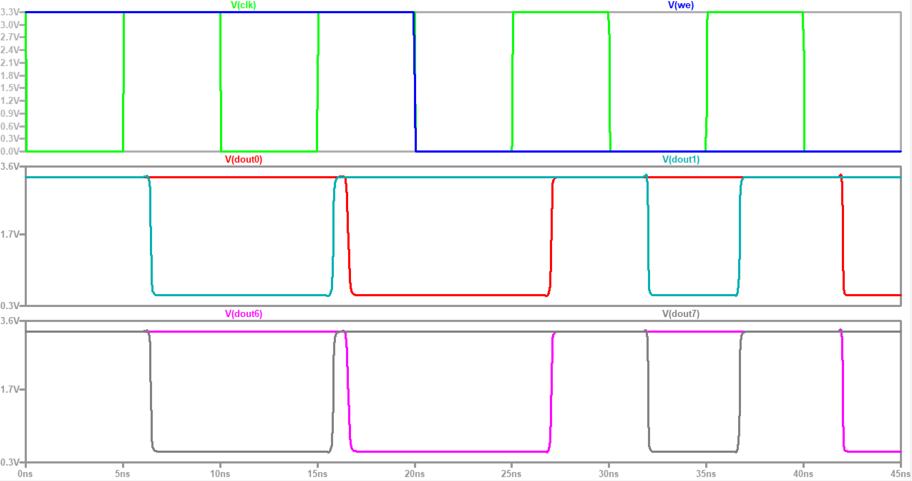
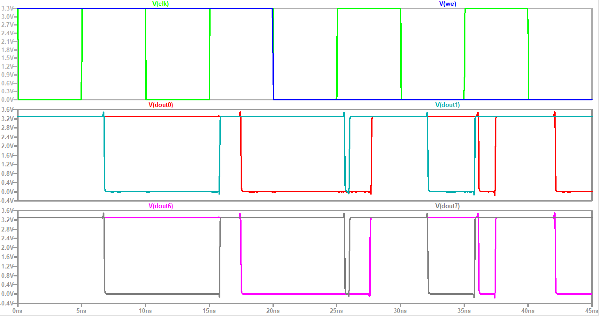
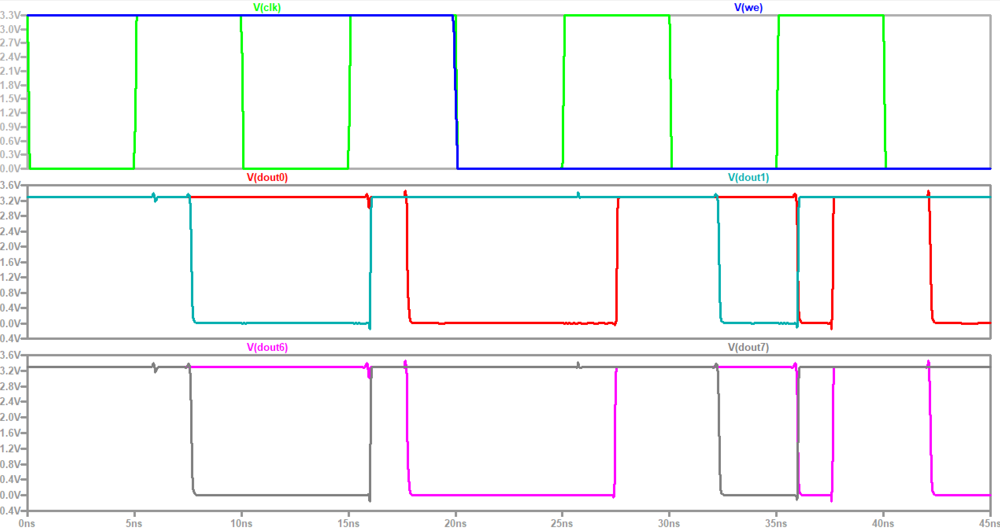
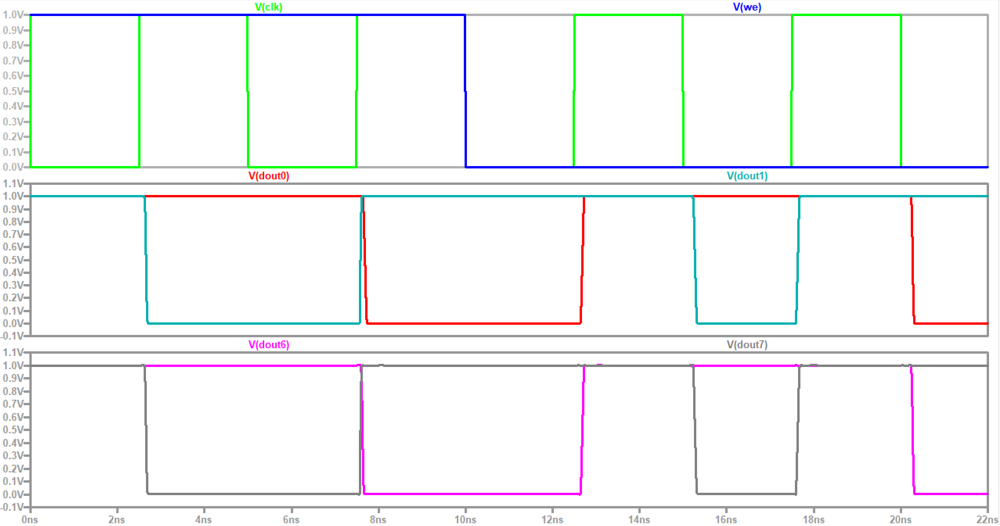

# SRAM 测试

## scn4m_subm

### 5x8

bitcell_array_r16_c16

### 5x16

bitcell_array_r16_c32

### 6x16

bitcell_array_r32_c32

### 7x16

bitcell_array_r32_c64

### 8x16

bitcell_array_r64_c64

### 9x16

bitcell_array_r64_c128

### 10x8

bitcell_array_r64_c64

### 11x8

bitcell_array_r64_c64

## freepdk45

### 5x8

bitcell_array_r16_c16

### 6x16

bitcell_array_r32_c32

