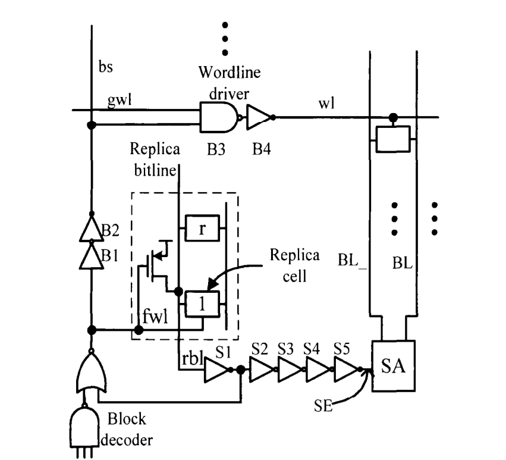
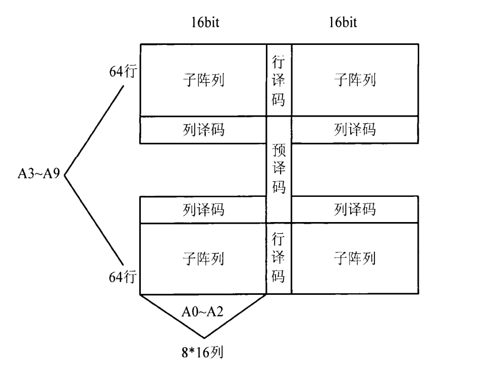

# SRAM 电路实现

问过 焦博 学长，他问了朱老师，但没有得到什么结果。

但经 焦博 学长的提醒，除了要关注外设模块的驱动能力问题，还需要注意：

- 阵列过大时，BL 导线长度过长以及附带的 Bit-cell 过大导致电容过大，使得读写速度慢的问题。

这可能就是导致我们之前的设计，尺寸无法继续拓展的原因（最大 1024x9）。

参考一篇浙大硕士毕业论文，[65nmSRAM设计](./65nmSRAM设计.pdf)，在 65nm 工艺下设计一款高性能、低功耗的 1024x32 大小的 SRAM 电路。


## 时序控制

确定就使用 Replica Bit-line。但可以修改一下控制单元的具体实现。

目前采用的是纯数字电路的方式，在这篇参考论文中提到了一种经典的 Replica bit-line 实现方案，描述如何产生读操作时的 WL 与 SA 信号。但论文中的实现不完整，需要再进行调整。



但因为 Compiler 需要一个比较通用的方案，应对不同工艺以及配置，可能纯数字会容易实现一些。


## Buffer

加 Buffer 是无法解决 BL 电容的问题的。所以要想支持大尺寸 SRAM，内存分块是必须的。

这篇论文中没有提到要插入 Buffer 的问题。可能是认为不是重点就没提？

但扇出的问题总还是需要解决，那就可以像老师说的一样，先给内存阵列分块，再给每个阵列单独加 Tree Buffer。


## 内存分块

以这篇论文使用的 SRAM 为例：

论文实现 1024x32 的 SRAM，一共 A[0] - A[9] 十位地址线：

- A[0] - A[2] 这 3 位作为列地址
- A[3] - A[9] 这 7 位作为行地址

这样阵列实际上应该为 128x256。论文中将其分为 4 块，每块为 64x128：



每侧两个 64x128 的内存阵列使用 8-1 的列译码器输出 16bit。最终输出 32bit。

这样把 128 行（行越多，BL 越长、挂载的 Bit-cell 越多）分配为两个 64 行的子阵列。

并且分块还可以使得各个外设模块分离，分别控制。最典型的就是预充电阵列，如果有四个子阵列，那么我们就不需要给所有子阵列都使得预充电，降低了功耗。


这里采用最简单的分块方式。将之前一个完整的 SRAM 去掉 mbist 接口与输入寄存器，剩下 LogicControl 与 Bank 形成一个 SRAMCore。SRAMCore 的接口与 SRAM 本身类似，使用 csb 端口作为使能信号。

而 SRAM 电路会包含至少一个 SRAMCore、MBIST 接口以及输入寄存器。存在多个 SRAMCore 时，类似于一个总线系统，使用块地址去掉哪个 SRAMCore 工作（控制 csb）。并且将所有 SRAMCore 的输出到一个选择器中选择。


## 地址分配

1. 地址最低位数作为列地址：局部性原理，通常访问的是比较靠近的地址，那么高位不变，使得译码器的结果可以复用之前的，减少功耗。
2. 接下来的地址都分配给行地址。
3. 但如果出现分块的情况，行地址的高位分配给块地址。


## 分块策略

需要确定一些常量：

- `MAX_CORE_ROW`：一个 SRAM Core 支持的最大行数
- `MAX_CORE_COL`：一个 SRAM Core 支持的最大列数
- `MAX_CORE_SIZE = MAX_CORE_ROW * MAX_CORE_COL ` ：一个 SRAM Core 允许的最大内存单元数量


- `MAX_COL_ADDRESS`：SRAM 允许的最大列地址位数
- `MAX_CORE_ADDRESS`：SRAM 允许的最大 Core 地址位数
- `MAX_SRAM_SIZE = 2^MAX_CORE_ADDRESS * MAX_CORE_SIZE   `


经过测试目前系统：

- `MAX_CORE_ROW = 64`
- `MAX_CORE_COL = 128`
- `MAX_CORE_SIZE = MAX_CORE_ROW * MAX_CORE_COL = 128 * 64 `

- `MAX_COL_ADDRESS = 3`
- `MAX_CORE_ADDRESS = 2`
- `MAX_SRAM_SIZE = 2^MAX_CORE_ADDRESS * MAX_CORE_SIZE = 1024 * 32   `


分块策略：输入地址宽度 `A`、字宽度 `W`，得到三个地址：Core 地址、行地址、列地址（实际上只需要 Core 与 列）。

1. 计算总内存单元大小：`TB = Totol Bit = 2^A * W`。

2. 如果 `TB > MAX_SRAM_SIZE`：编译失败，不支持这么大的 SRAM。

3. 如果 `TB < MAX_CORE_SIZE`，有可能可以使用一个 Core 完成，开始尝试使用一个 Core 完成：

   尽可能使得阵列形成矩形的同时，满足最大 Row 与 Col，以及最大列地址的约束：

   ````rust
   def as_one_core(addr_width: i32, word_width: i32) -> Option<i32> {
       let array_configs = (0..MAX_COL_ADDRESS).into_iter()
           .map(|col_addr| -> (i32, i32, i32, i32) {
               // Rust not support ^, but you konw~
               let row = 2 ^ (A - col_addr);
               let col = W * 2 ^ col_addr;
               let delta = (row - col).abs();
               (row, col, col_addr, delta)	
           })
           .collect::<Vec<_>>();
       array_configs.sort_by_ket(|(_, _, _, d)| d);
   
       for (row, col, col_addr, _) in array_configs {
           if row <= MAX_CORE_ROW && col <= MAX_CORE_COL {
               return Some(col_addr);
           }
       }
       
       None
   } 
   ````

   如果条件满足，那么退出过程，确定不使用 Core 地址，并且输出对应行、列地址。否则说明不可使用一个 Core 组织，继续执行下一步。

4. 到这一步，确定需要使用多个 Core：

   1. 使用 1 位 Core 地址，判断 (A-1, W) 是否可以形成一个 Core
   2. 使用 2 位 Core 地址，判断 (A-2, W) 是否可以形成一个 Core
   3. ... 依次类推到最大 Core 地址。

   是要先成功，就可以直接返回。所有都失败就说明编译失败。

> 实际上 3 是 4 的特殊情况：即 Core 地址为 0，但是为了展示尝试配置一个 Core 的情况，特地把情况 3 单独写出来。
