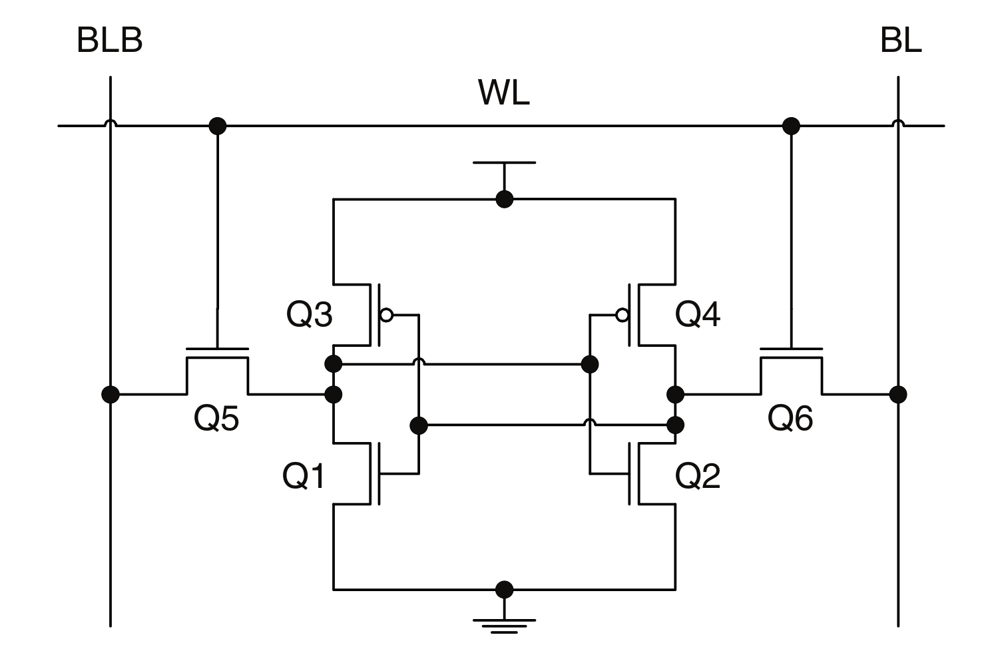
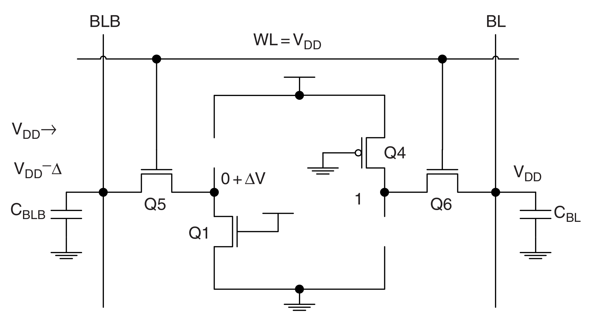
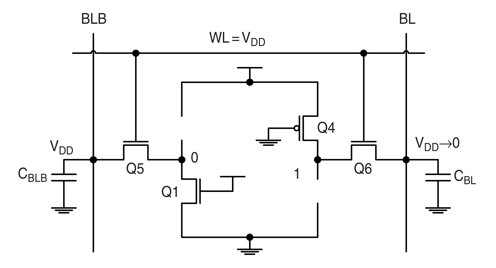
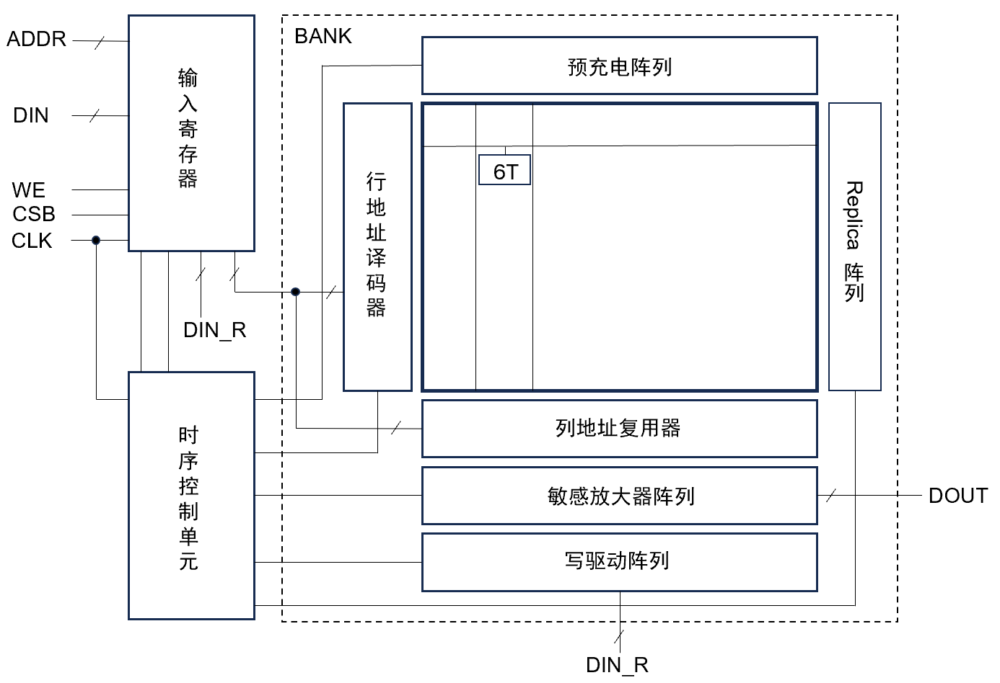
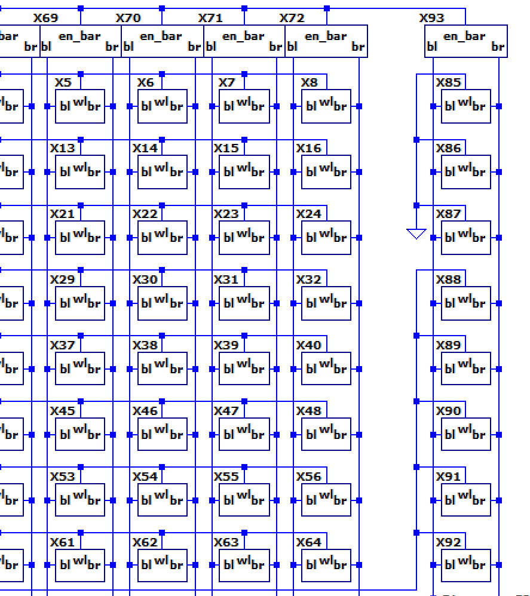
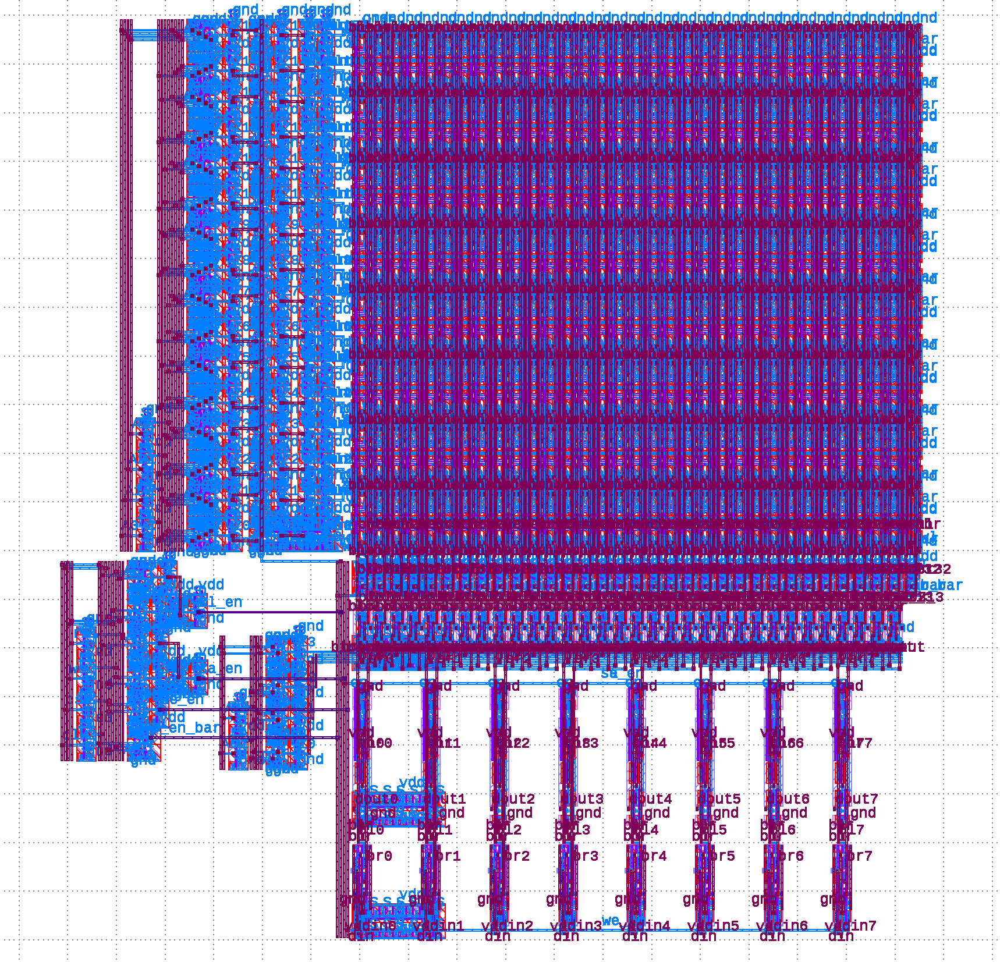

# RBL 问题描述

## SRAM 基本原理

### SRAM 单元

内部两个反相器锁存状态，Q5、Q6 为开关管。

### SRAM 读数据原理

读 1 为例：

1. BL/BLB 预充电至 VDD，WL 开启
2. BLB 通过 Q5 和 Q1 放电
3. BL 与 BLB 电压差足够被放大器检测，读出 1

### SRAM 写数据原理

写 0 为例

1. BLB 充电至 VDD，BL 为 0
2. VDD 通过 Q4、Q6 向 BL 充电，V1 电压下降
3. 到 V1 下降至反向器阈值，将状态翻转

## SARM 电路结构

一个完整的 SRAM 电路需要其他外围电路，最简单的 SRAM 原理图大致为：

- Bitcell 阵列：二维单元阵列，同一行共享 WL，同一列共享 BL/BLB
- Replica Bitcells 阵列：用来做时序控制，之后详细说明
- 行译码器、列选择器：地址选择
- 预充电：读数据之前需要预充电
- 写驱动：写数据需要让 BL/BLB 为 0/1 或 1/0
- 敏感放大器：读数据检测 BL、BLB 电压差，转为数字信号输出
- 逻辑控制模块：控制四个外设的时序，保证读写工作流程

## 时序控制

SRAM 逻辑控制模块需要产生：p_en_bar（预充电）、we_en（写使能）、sa_en（放大器使能）、wl_en（位线选择），四个控制信号。

### 读操作

因为读操作的特殊性，当 BLB 与 BL 电压差足够被放大器检测，就可关闭 WL，停止放电，并开启 SA，开始放大输出数字信号。如果这个时机过早，电压差不够被检测；如果时机过晚，造成无效的放电（浪费功耗）读数据时间增长。

所以需要一种机制来检测何时可以关闭 WL、开启 SA。

### RBL 原理

replica bitcell 直接位于 sram bank 上，其寄生参数，特别是字线电容与 正常工作 的 bitcell 一致。

如上图，左侧为正常工作 的 bitcell 阵列；右侧为 8 个 replica bitcells，它们共用 bitline，称为 rbl，其中三个 cell 的 wl 总是为 0，剩下 5 个直接连接到 wl_en，所以不管需要对哪个 cell 进行读写，总会激活这 5 个 replica bitcells。

当对 SRAM 进行写操作的时候，总是对这五个 cells 写入 0。对 SRAM 进行读操作的时候，也会同样对这 5 个 bitcell 进行操作：rbl 预充电、放电。

replica 的原理就是：通过检测这个 rbl，将其变化量作为正常的 bitcell 是否可以被敏感放大器检测到的标志。

但实际上，replica bitcells 的 rbl 没有连接任何敏感放大器，其直接连接到了 logic control 中的 rbl，进入到反相器中。所以二者的阈值实际上并不相同：

- normal cell 的字线需要下降到：足够触发敏感放大器（约为 VDD/10）；
- replica cell 的子线连接到 Logic Control 中的反相器，其需要下降到触发反相器（约为 VDD/2）；

为了让二者达到阈值的时间大致相同，那么需要保证：replica 放电电流为 normal cell 放电电流的 5 倍：
$$
\Delta Q = C \Delta U = It
$$
为了达到电流要求，所以使用 5 个 bitcell 进行放电。

使用这个技术，可以比较好得跟踪 BL/BLB 压降，完成对 SRAM 外设的时序控制。

## 版图的问题

目前主要问题是如何放置 Replica bitcell 以及 rbl 的走线。

先放置工作 Bitcell 阵列，假设其左侧是行地址 Decoder，那么其产生的 WL 水平穿过整个阵列。所以 Replica bitcell 就只能放在 工作阵列的右侧（因为 Replica bitcell 的 WL 和正常工作的 WL 不可以直接相连，其要么连接到 0，要么连接 wl_en）。

这导致一个问题，如上图，阵列最右侧是一列 Replica bitcell。而系统的时序控制单元在左下角（左下角两个模块，左侧的是逻辑控制单元，右侧的是列地址译码器。）

而 Replica bitcell 会产生 RBL 信号，其需要输入到逻辑控制单元中。RBL 就需要从最右侧连接到左侧，传输距离很远，而这个信号是传输模拟信号的，也不能加 Buffer。

是否有更好的布局方式来解决这个问题。
